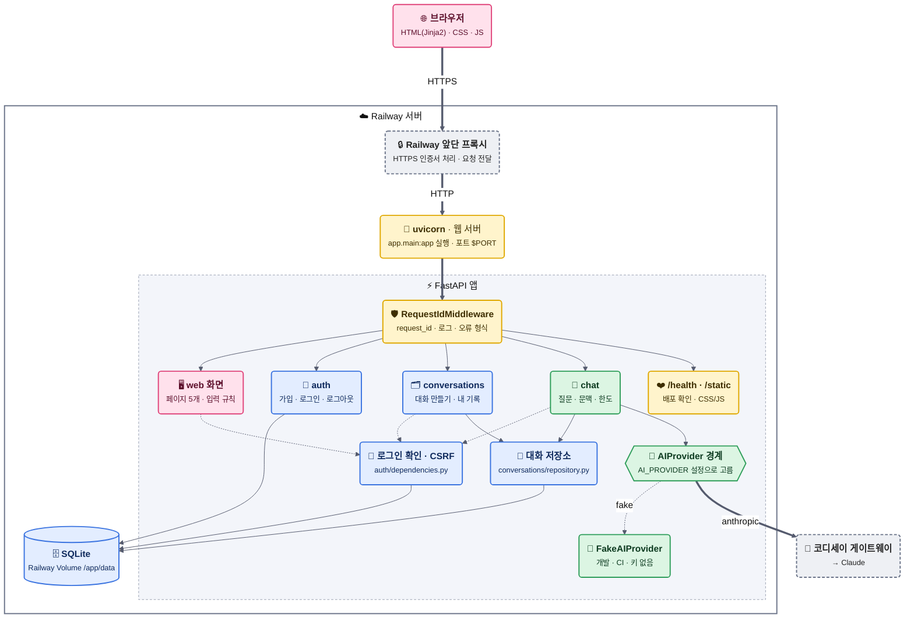
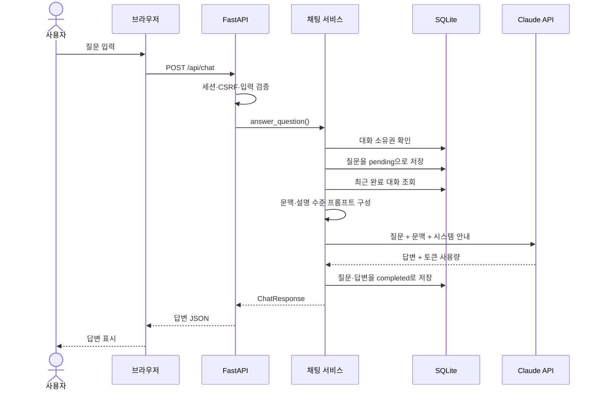
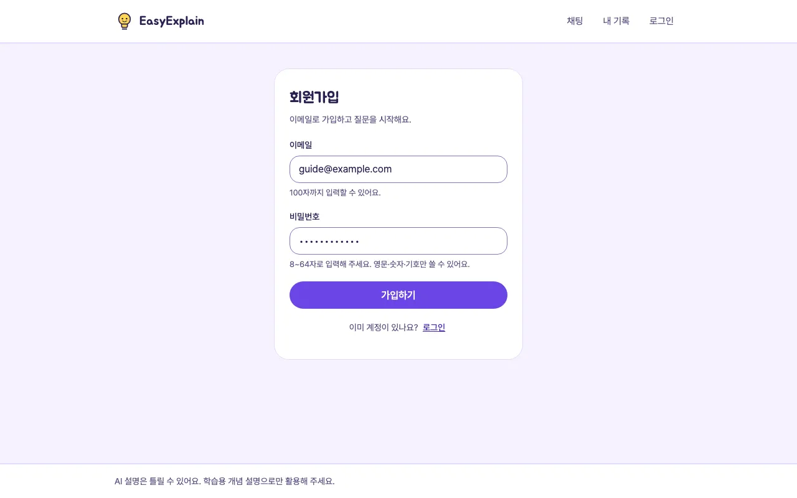
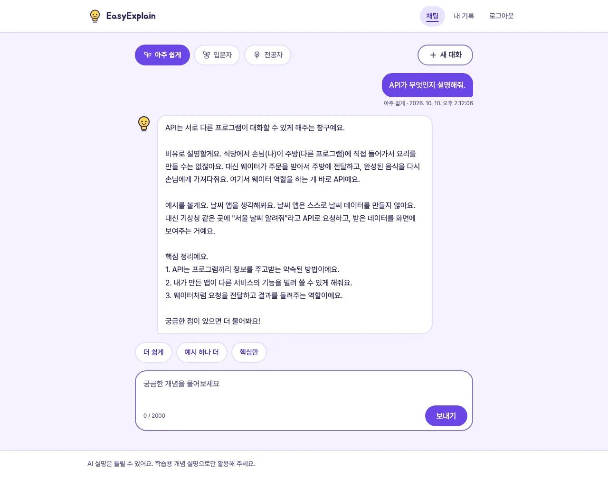
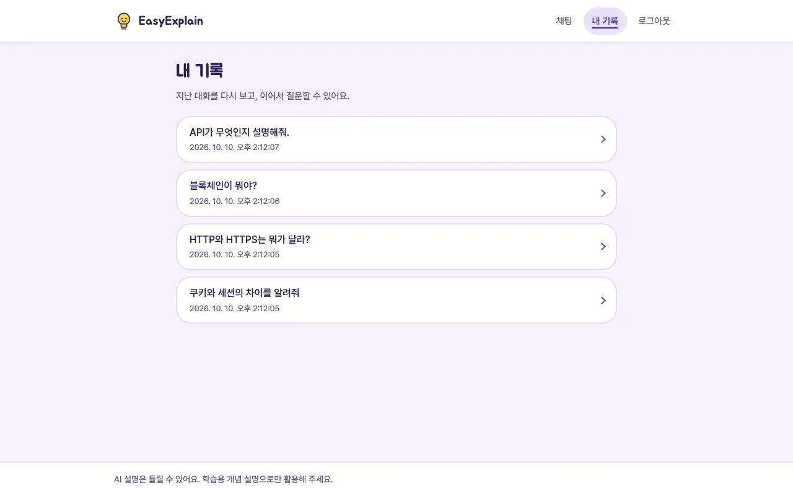
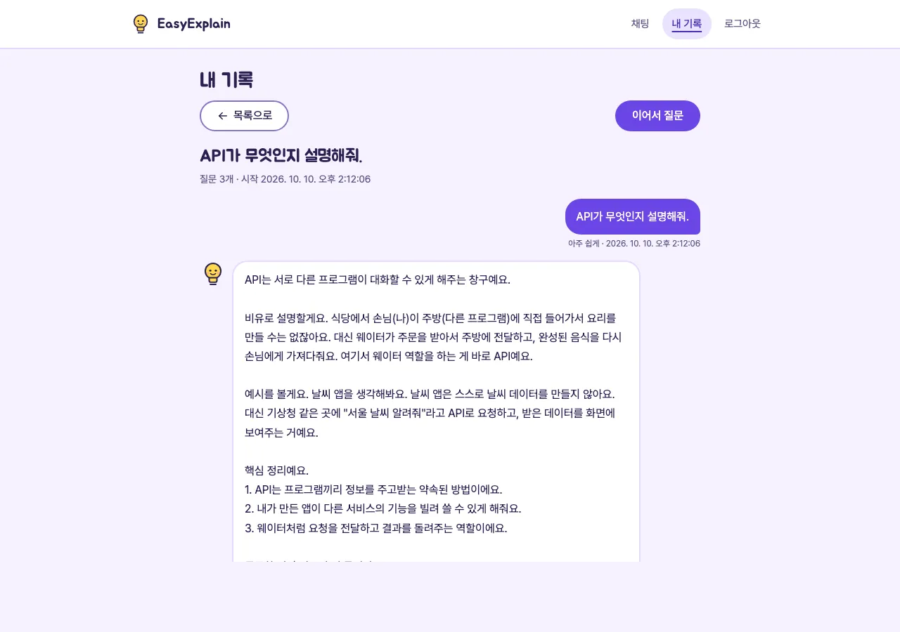
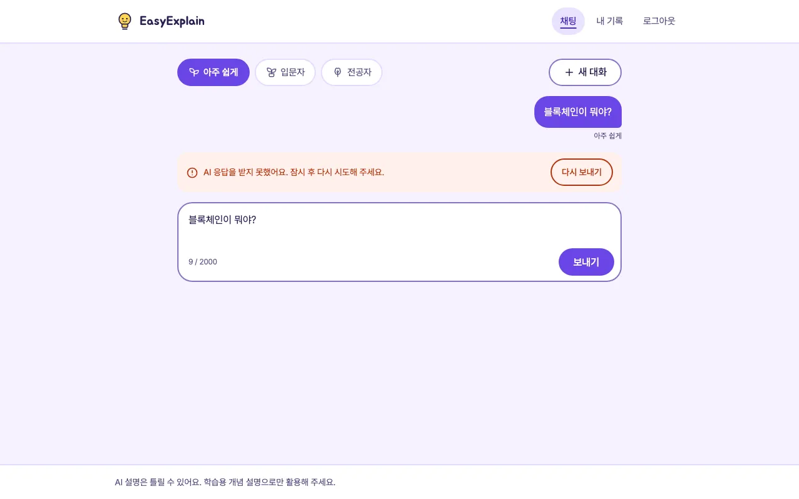
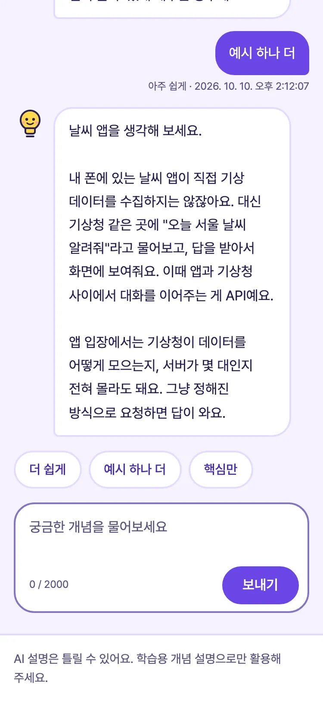

# EasyExplain

> 모르는 개념을 물어보면 **설명 수준(아주 쉽게 / 입문자 / 전공자)** 에 맞춰 풀어 주고,
> "더 쉽게", "예시 하나 더" 같은 후속 질문으로 이해를 넓혀 가는 AI 챗봇입니다.

Codyssey **B7-1 Term Project「웹 기반 AI 챗봇 서비스 개발 프로젝트」** · 4인 팀

> **현재 상태:** 필수 기능 구현, 외부 배포, DB 확인·백업 리허설 완료. 제출 점검(EE-24)이 남았습니다. 과제 요구사항별 근거와 진행 상태는 [6장](#6-과제-요구사항과-제출-점검).

### 🧭 평가자 길 안내

| 확인할 내용 | 바로 가기 |
|---|---|
| 서비스 URL | https://codyssey-b7-1-term-project-production.up.railway.app |
| 과제 요구사항별 근거와 상태 | [6장](#6-과제-요구사항과-제출-점검) |
| 시스템 구조 (아키텍처·컴포넌트) | [1장 구조도](#1-과제-소개) · [2장 폴더 구조](#2-폴더-구조) |
| API 명세 (요청·응답 예시, 오류 코드) | [docs/spec/api.md](docs/spec/api.md) |
| DB 구조 (테이블·필드) | [docs/spec/db.md](docs/spec/db.md) |
| DB 확인 방법 | 내 기록 API·화면(`/history`) · [확인용 SQL](scripts/check_logs.sql) · [7장](#7-db-확인백업복구) |
| 실행·배포 방법, 환경 변수 | [5장](#5-실행-방법) · [배포 문서 8장](docs/team/3-deploy-options.md#8-railway-설정-절차) |
| 역할과 개인별 작업 | [3장 팀·기능 표](#3-주요-기능과-역할-분담) (담당·PR 칸) |
| 겪은 문제와 해결 | [트러블슈팅 기록](docs/team/4-troubleshooting.md) |
| 확장성·장애·보안·LLM 품질 점검 | [퍼실리테이터 사전 질문 답변](docs/team/5-facilitator-questions.md) |

<details>
<summary><b>👥 팀원용 문서 안내 — 언제 무엇을 읽나요?</b></summary>

| 언제 | 문서 | 내용 |
|---|---|---|
| ① 첫 회의 | [docs/team/1-kickoff.md](docs/team/1-kickoff.md) | 과제 소개, 역할 정하기, 커밋·API·DB 합의 |
| ② 착수할 때 + 매번 | [CONTRIBUTING.md](CONTRIBUTING.md) | 처음 할 일·뼈대 둘러보기, **매번 하는 루틴 11단계**, 역할별 안내 |
| 매번 | [작업 보드](https://github.com/orgs/easy-explain/projects/1) | 24개 작업 이슈와 진행 상황 (내 작업: `assignee:@me`) |
| 작업 중 수시로 | [docs/spec/api.md](docs/spec/api.md) · [docs/spec/db.md](docs/spec/db.md) | API 명세, DB 구조 (바꾸려면 PR 먼저) |
| ③ 평가 전 | [docs/team/2-evaluation-example.md](docs/team/2-evaluation-example.md) | 예상 진행 대본, 공통 질문 |
| ③ 평가 전 | [docs/team/eval/](docs/team/eval/) | 역할별 예상 질문·읽을 코드·실습 (**자기 파일만** 고침) |
| 배포할 때 | [docs/team/3-deploy-options.md](docs/team/3-deploy-options.md) | 배포 방식 결정, Railway 설정 절차 |
| 문제가 생겼을 때 | [docs/team/4-troubleshooting.md](docs/team/4-troubleshooting.md) | 겪은 문제와 해결 기록 |
| ③ 평가 전 | [docs/team/5-facilitator-questions.md](docs/team/5-facilitator-questions.md) | 퍼실리테이터 사전 질문 답변·점검 (✅🟨❌) |
| 읽지 않아도 됨 | `AGENTS.md`, `CLAUDE.md` | AI 코딩 도구가 읽는 규칙 (CONTRIBUTING 요약본) |

</details>

---

## 1. 과제 소개

**"AI 챗봇 웹사이트를 4명이 만들어서, 누구나 접속할 수 있게 인터넷에 올리는 것"** 입니다.
AI 를 직접 만드는 게 아니라, 이미 있는 AI(Claude)를 **우리 서버가 대신 불러 주는 서비스**를 만듭니다.

```
 웹 화면 (브라우저)  ──질문──▶  우리 서버 (FastAPI)  ──질문 + 이전 대화──▶  AI API (Claude)
                    ◀─답변──                       ◀────────답변────────
                                       │
                                       ▼ 질문·답변·시각 저장 / 조회
                                   DB (SQLite)
```

### 시스템 아키텍처

앱은 FastAPI를 중심으로 웹 페이지와 API를 함께 제공하는 단일 서버 구조입니다.
`app/main.py`가 공통 설정·미들웨어·DB·라우터를 조립하고, 채팅 요청의 업무 흐름은
`app/chat/service.py`가 담당합니다.



**범례** — 상자 색은 담당자


#### 채팅 요청 처리 순서



인증이 필요한 요청은 세션 쿠키와 CSRF 토큰을 확인하며, 사용자의 `user_id`는 요청 본문이
아니라 서버 인증 결과로 결정됩니다. AI 키는 브라우저에 전달하지 않고 서버의 제공자 계층에서만 사용합니다.

| 부품 | 비유 | 하는 일 |
|---|---|---|
| 웹 화면 | 🍽️ 손님 테이블과 메뉴판 | 질문을 입력하고 답을 보는 곳 |
| 우리 서버 (FastAPI) | 🧑‍💼 홀 직원 | 손님 확인(로그인), 주문을 요리사에게 전달, 기록, 문제 생기면 안내 |
| AI API (Claude) | 👨‍🍳 요리사 | 실제 설명(요리)을 만듦. 손님은 주방에 직접 못 들어감 (🔑 키는 서버만 가짐) |
| DB (SQLite) | 📒 주문 장부 | 누가 언제 무엇을 묻고 어떤 답을 받았는지 기록 |

### 반드시 지켜야 할 요구사항

| # | 요구사항 | 쉽게 말하면 | 구현 위치 | 확인 테스트 |
|---|---|---|---|---|
| ① | 웹 UI | 질문을 입력하고 같은 화면에서 답을 봄 | [chat.html](app/templates/chat.html) · [chat.js](app/static/js/chat.js) | [test_chat_page.py](tests/web/test_chat_page.py) · [test_chat_js_behavior.py](tests/web/test_chat_js_behavior.py) |
| ② | 인증 | 회원가입·로그인, **로그인한 사람만** 챗봇 사용 | [app/auth/](app/auth/) | [tests/auth/](tests/auth/) · [통합: 실패 경로](tests/integration/test_failure_paths.py) |
| ③ | AI 처리 | AI 호출은 **서버에서만**, **이전 대화를 기억** | [service.py](app/chat/service.py) · [context.py](app/chat/context.py) | [test_chat_api.py](tests/chat/test_chat_api.py) · [test_context.py](tests/chat/test_context.py) |
| ④ | 대화 기록 | 질문·답변·사용자·시각을 DB 에 쌓고 **사용자별로 조회** | [models.py](app/db/models.py) · [app/conversations/](app/conversations/) | [tests/conversations/](tests/conversations/) · [통합: 전체 흐름](tests/integration/test_user_journey.py) |
| ⑤ | 안정성 | 서버 로그, AI 실패·지연에도 **서버가 안 죽고 안내**, 입력 검증 | [errors.py](app/core/errors.py) · [logging.py](app/core/logging.py) · [service.py](app/chat/service.py) | [통합: 실패 경로](tests/integration/test_failure_paths.py) · [통합: 요청 로그](tests/integration/test_request_logs.py) · [배포 로그 추적 캡처](docs/team/img/railway-log-request-trace.png) |
| ⑥ | 배포 | 평가 때 **외부에서 접속 가능한 URL** | Railway + Volume ([5장](#5-실행-방법)) | [배포 기록](docs/team/3-deploy-options.md#8-railway-설정-절차) · [배포 AI 검증](docs/team/chat/EE-23.md) |
| ⑦ | 협업 | 브랜치·PR 머지, **1인당 의미 있는 커밋 10개 이상** | [CONTRIBUTING.md](CONTRIBUTING.md) · [ci.yml](.github/workflows/ci.yml) | PR 목록 · `git shortlog -sne --no-merges origin/main` |

과제 원문 항목마다 어디서 만족하는지는 [6장 과제 요구사항과 제출 점검](#6-과제-요구사항과-제출-점검)에 있습니다.

---

## 2. 폴더 구조

```
app/
├─ main.py            # 앱 조립 (모든 부품 연결)
├─ health.py          # 서버 상태 확인 GET /health
├─ core/              # 설정 · 공통 오류 · 요청 ID · 서버 로그
├─ db/                # DB 연결, 테이블 정의
├─ auth/              # 회원가입·로그인 API, 로그인 확인
├─ conversations/     # 대화 만들기·내 기록 API
├─ chat/              # 채팅 API, AI 호출
├─ web/               # 페이지 주소
├─ templates/         # HTML
└─ static/            # CSS · JS
tests/                # 영역별 자동 테스트
docs/                 # API 명세 · DB 구조 · 평가 대비 가이드
scripts/              # DB 확인 SQL
CONTRIBUTING.md       # 작업 길잡이 (환경 준비 → 매번 하는 루틴)
AGENTS.md             # AI 코딩 도구용 규칙
```

- API 요청·응답 예시와 오류 코드: [docs/spec/api.md](docs/spec/api.md)
- DB 테이블·필드 설명: [docs/spec/db.md](docs/spec/db.md)

---

## 3. 주요 기능과 역할 분담

### 팀

|  |  |  |  |
|:---:|:---:|:---:|:---:|
| 이초롱<br>[@0802222](https://github.com/0802222) | 송지윤<br>[@js910](https://github.com/js910) | 나현준<br>[@vivleon](https://github.com/vivleon) | 유민규<br>[@Minkyu01](https://github.com/Minkyu01) |
| **L 팀장**<br>공통 뼈대 · 오류·로그 · CI · 통합 · 배포 | **A 인증·DB**<br>회원·로그인 · 접근 제어 · DB · 내 기록 | **B AI·채팅**<br>AI 호출 · 설명 수준 · 문맥 유지 · AI 오류 | **C 화면**<br>웹 화면 · API 연결 · 사용성 |

| 역할 | 이름 | 담당 |
|---|---|---|
| **L** 팀장 | 이초롱 | 공통 뼈대, 오류·로그, CI, 통합, 배포 |
| **A** | 송지윤 | 회원·로그인·접근 제어, DB, 내 기록 (서버) |
| **B** | 나현준 | AI 호출, 설명 수준, 문맥 유지, AI 오류 (서버) |
| **C** | 유민규 | 웹 화면, API 연결, 사용성 (화면) |

개인별 커밋 수 (2026-10-16, `git shortlog -sne --no-merges origin/main`): 유민규 90 · 이초롱 44 · 송지윤 35 · 나현준 34

### 기능

로그인한 사용자가 **설명 수준을 골라 개념을 질문하면, AI 가 이전 대화를 기억하며 쉽게 설명**해 주는 챗봇입니다.
대화는 저장되어 나중에 다시 보고 이어서 질문할 수 있습니다. 자세한 기능과 담당은 아래 표를 참고하세요.

**사용 흐름:** 로그인 → 설명 수준 선택 → "API가 뭐야?" 질문 → 답변 → [더 쉽게]·후속 질문 → 내 기록에서 이어 보기

| 대분류 | 기능 | 설명 | 담당 | API · 화면 | 상태 | PR |
|---|---|---|---|---|---|---|
| **계정** | 회원가입 | 이메일·비밀번호, 비밀번호는 해시로 저장 | A 가입 API·DB<br>C 가입 화면 | `POST /api/auth/signup`<br>`/signup` | ✅ | [#35](https://github.com/easy-explain/Codyssey-B7-1-Term-Project/pull/35) · [#38](https://github.com/easy-explain/Codyssey-B7-1-Term-Project/pull/38) |
| | 로그인·로그아웃 | 세션 쿠키 발급·삭제 | A 세션 처리<br>C 로그인 화면·로그아웃 버튼 | `POST /api/auth/login`<br>`POST /api/auth/logout`<br>`/login` | ✅ | [#37](https://github.com/easy-explain/Codyssey-B7-1-Term-Project/pull/37) · [#38](https://github.com/easy-explain/Codyssey-B7-1-Term-Project/pull/38) · [#41](https://github.com/easy-explain/Codyssey-B7-1-Term-Project/pull/41) |
| | 접근 제어 | 비로그인은 API 401, 페이지는 로그인으로 이동, CSRF 검사 | A | `GET /api/auth/me` | ✅ | [#37](https://github.com/easy-explain/Codyssey-B7-1-Term-Project/pull/37) · [#45](https://github.com/easy-explain/Codyssey-B7-1-Term-Project/pull/45) |
| **채팅** | 질문·답변 | 같은 화면에 답 표시, 대기 중 버튼 잠금 | B 채팅 API·AI 호출<br>C 채팅 화면 | `POST /api/chat`<br>`/chat` | ✅ | [#43](https://github.com/easy-explain/Codyssey-B7-1-Term-Project/pull/43) · [#41](https://github.com/easy-explain/Codyssey-B7-1-Term-Project/pull/41) · [#47](https://github.com/easy-explain/Codyssey-B7-1-Term-Project/pull/47) |
| | 설명 수준 | 아주 쉽게 / 입문자 / 전공자 | B 수준별 프롬프트<br>C 수준 선택 UI | `POST /api/chat` 의 `level` | ✅ | [#8](https://github.com/easy-explain/Codyssey-B7-1-Term-Project/pull/8) · [#43](https://github.com/easy-explain/Codyssey-B7-1-Term-Project/pull/43) · [#41](https://github.com/easy-explain/Codyssey-B7-1-Term-Project/pull/41) · [#55](https://github.com/easy-explain/Codyssey-B7-1-Term-Project/pull/55) |
| | 문맥 유지 | 같은 대화의 최근 5턴을 기억 | B | (서버 내부) | ✅ | [#8](https://github.com/easy-explain/Codyssey-B7-1-Term-Project/pull/8) · [#43](https://github.com/easy-explain/Codyssey-B7-1-Term-Project/pull/43) |
| | 후속 버튼 | 더 쉽게 / 예시 하나 더 / 핵심만 | C | `/chat` | ✅ | [#41](https://github.com/easy-explain/Codyssey-B7-1-Term-Project/pull/41) |
| | 설명 품질 증빙 | 실제 AI 로 수준별·후속 문맥 답변 샘플과 검토 | B | 수동 수집 | ✅ | [#46](https://github.com/easy-explain/Codyssey-B7-1-Term-Project/pull/46) · [#55](https://github.com/easy-explain/Codyssey-B7-1-Term-Project/pull/55) |
| **대화 기록** | 대화 만들기 | 새 대화 시작, 첫 질문으로 제목 저장 | A | `POST /api/conversations` | ✅ | [#42](https://github.com/easy-explain/Codyssey-B7-1-Term-Project/pull/42) · [#53](https://github.com/easy-explain/Codyssey-B7-1-Term-Project/pull/53) |
| | 내 기록 조회 | 내 대화 목록·상세, 이어서 질문, 남의 대화는 볼 수 없음 | A 조회 API·권한<br>C 기록 화면 | `GET /api/me/conversations`<br>`GET /api/me/chats`<br>`/history` | ✅ | [#42](https://github.com/easy-explain/Codyssey-B7-1-Term-Project/pull/42) · [#52](https://github.com/easy-explain/Codyssey-B7-1-Term-Project/pull/52) |
| | DB 확인 도구 | 사용자별 최근 대화 조회 SQL, 백업·복구 | A | `scripts/check_logs.sql` | ✅ | [#57](https://github.com/easy-explain/Codyssey-B7-1-Term-Project/pull/57) |
| **안정성** | 오류 안내 | AI 지연·실패·DB 오류에도 서버 유지, 공통 형식으로 안내 | L 공통 오류 형식<br>B AI 오류 처리<br>C 오류 메시지 표시 | 모든 API | ✅ | [#4](https://github.com/easy-explain/Codyssey-B7-1-Term-Project/pull/4) · [#43](https://github.com/easy-explain/Codyssey-B7-1-Term-Project/pull/43) · [#44](https://github.com/easy-explain/Codyssey-B7-1-Term-Project/pull/44) · [#47](https://github.com/easy-explain/Codyssey-B7-1-Term-Project/pull/47) |
| | 입력 검증 | 빈 질문, 2,000자 초과, 잘못된 값 차단 | B 서버 검증<br>C 화면 입력 제한 | `POST /api/chat` | ✅ | [#4](https://github.com/easy-explain/Codyssey-B7-1-Term-Project/pull/4) · [#43](https://github.com/easy-explain/Codyssey-B7-1-Term-Project/pull/43) · [#41](https://github.com/easy-explain/Codyssey-B7-1-Term-Project/pull/41) |
| | 중복 요청·재시작 복구 | 같은 요청 번호는 AI 를 다시 부르지 않음, 재시작 때 처리 중이던 질문은 중단 처리 | B 중복 처리<br>A 재시작 복구 | `POST /api/chat` | ✅ | [#43](https://github.com/easy-explain/Codyssey-B7-1-Term-Project/pull/43) · [#48](https://github.com/easy-explain/Codyssey-B7-1-Term-Project/pull/48) |
| | 질문 횟수 제한 | 사용자별 1분·서비스 전체 하루 한도, 단일 서버 기준 | B | `POST /api/chat` | ✅ | [#44](https://github.com/easy-explain/Codyssey-B7-1-Term-Project/pull/44) |
| | 서버 로그 | 요청·AI 호출·DB 저장을 요청 ID 로 묶어 기록 | L 요청 로그<br>B AI 호출 로그<br>A DB 저장 로그 | 서버 로그 | ✅ | [#4](https://github.com/easy-explain/Codyssey-B7-1-Term-Project/pull/4) · [#43](https://github.com/easy-explain/Codyssey-B7-1-Term-Project/pull/43) · [#42](https://github.com/easy-explain/Codyssey-B7-1-Term-Project/pull/42) |
| | 상태 확인 | 서버·DB 정상 여부 | L | `GET /health` | ✅ | [#4](https://github.com/easy-explain/Codyssey-B7-1-Term-Project/pull/4) |
| **화면** | 접근성·모바일 | 키보드만으로 사용, 글자 대비, 휴대폰 화면, 사용 가이드 | C | 모든 화면 | ✅ | [#52](https://github.com/easy-explain/Codyssey-B7-1-Term-Project/pull/52) · [#56](https://github.com/easy-explain/Codyssey-B7-1-Term-Project/pull/56) |
| **배포·협업** | 외부 배포 | 공개 URL, 재시작해도 기록 유지 | L | 서비스 URL | ✅ | [#50](https://github.com/easy-explain/Codyssey-B7-1-Term-Project/pull/50) |
| | 자동 검사 (CI) | PR 마다 코드 검사·테스트 자동 실행 | L | GitHub Actions | ✅ | [#4](https://github.com/easy-explain/Codyssey-B7-1-Term-Project/pull/4) |

⬜ 미착수 · 🟨 일부 완료 · ✅ 완료 — 기능을 머지할 때 상태와 PR 번호를 함께 적습니다.

B 영역의 처리 순서와 검증 자료는 `app/chat/` 안내 문서에 모았습니다:
[EE-13 처리 순서](docs/team/chat/EE-13.md) · [EE-16 횟수 제한](docs/team/chat/EE-16.md) · [EE-19 품질 샘플](docs/team/chat/EE-19.md) · [#54 반복 질문 보완](docs/team/chat/ISSUE-54.md)

### 비제공 기능

과제의 핵심인 **로그인 → AI 질문 → 기록 저장 → 배포**를 안정적으로 완성하는 데 집중하기 위해,
아래 기능은 제공하지 않습니다. 필수 기능이 끝나도 기능을 늘리기보다 안정화를 우선합니다.

- PDF·파일 업로드
- 웹 검색 (최신 정보 반영)
- 음성·이미지 입력
- 소셜 로그인 (카카오, 구글 등)
- 결제
- 실시간 스트리밍 응답 (답변이 한 글자씩 나오는 방식)
- 관리자 화면 — 모든 사용자의 대화를 보는 화면은 공개 URL 에서 개인정보 노출 위험이 커서 만들지 않습니다.
  과제의 "DB 확인 가이드"(3가지 중 1개 이상)는 **내 기록 API**(`GET /api/me/chats`)와 **확인용 SQL**(`scripts/check_logs.sql`)로 제공합니다.
- 의료·법률·투자 조언 — AI 설명은 틀릴 수 있어 학습용 개념 설명으로만 제공합니다

---

## 4. 기술 스택

| 도구 | 무엇인가 | 왜 썼나 |
|---|---|---|
| **Python 3.12** | 프로그래밍 언어 | 과제 지정 |
| **FastAPI** | 파이썬으로 웹 서버를 만드는 도구 | 과제 지정 (아래 설명) |
| **Uvicorn** | FastAPI 서버를 실제로 켜 주는 프로그램 | FastAPI 표준 실행기 |
| **Jinja2** | HTML 에 데이터를 끼워 넣는 템플릿 도구 | 별도 프런트 서버(React 등) 없이 화면 제공 |
| **SQLite** | 파일 하나로 동작하는 DB | 과제 권장 (아래 설명) |
| **SQLModel** | 파이썬 클래스로 DB 테이블을 다루는 도구 | SQL 을 덜 쓰고 실수 줄이기 |
| **Claude (anthropic SDK)** | AI 모델과 공식 연결 도구 | 코디세이 AI 게이트웨이 제공 |
| **Argon2 (pwdlib)** | 비밀번호를 안전하게 해시하는 방식 | 비밀번호 평문 저장 방지 |
| **uv** | 파이썬 버전·패키지를 맞춰 주는 도구 | 4명의 개발 환경을 똑같이 |
| **pytest · ruff** | 자동 테스트 · 코드 검사 | PR 마다 품질 확인 |

### FastAPI 는 뭔가요?

**"이 주소로 요청이 오면 이 함수를 실행해라"** 를 파이썬으로 쉽게 적게 해 주는 웹 서버 도구입니다.

```python
@router.get("/health")          # 누군가 /health 로 접속하면
def health():
    return {"status": "ok"}     # 이 결과를 JSON 으로 돌려준다
```

- **라우팅:** 주소(`/api/chat`)와 함수를 연결
- **입력 검증:** "level 은 easy/beginner/advanced 중 하나" 같은 규칙을 적어 두면 틀린 요청을 자동으로 거절
- **자동 문서:** 서버를 켜고 `/docs` 에 들어가면 모든 API 를 보고 직접 호출해 볼 수 있음 (로컬 개발용. 운영 서버 `APP_ENV=production` 에서는 꺼 둠)

### SQLite 와 MySQL 은 뭐가 다른가요?

둘 다 SQL 로 쓰는 관계형 DB 지만, **동작 방식이 다릅니다.**

| | SQLite | MySQL |
|---|---|---|
| 형태 | **파일 하나** (`easyexplain.db`) | 따로 설치해서 켜 두는 **DB 서버 프로그램** |
| 설치·설정 | 없음 (파이썬에 내장) | 설치, 계정·비밀번호·포트 설정 필요 |
| 접속 | 우리 서버가 파일을 직접 읽고 씀 | 네트워크로 DB 서버에 접속 |
| 동시 쓰기 | 한 번에 하나씩 (작은 서비스엔 충분) | 많은 사용자가 동시에 써도 됨 |
| 어울리는 곳 | 소규모 서비스, 학습, 앱 내장 | 사용자가 많은 서비스, 여러 서버가 같은 DB 사용 |

**우리가 SQLite 를 고른 이유:** 과제 권장이고, 설정이 거의 없어 기능 개발에 집중할 수 있으며,
평가 규모(수십 명)에는 충분합니다. 단, **DB 가 파일이므로 배포 서버에서 파일이 지워지지 않는 저장 공간**에 둬야 합니다.

---

## 5. 실행 방법

EasyExplain **웹 서버를 내 컴퓨터에서 실행**하는 방법입니다. (Python 3.12 는 uv 가 자동으로 준비합니다)

```bash
# 1) 패키지 관리 도구 uv 설치
brew install uv                       # macOS (Windows: https://docs.astral.sh/uv/ 참고)

# 2) 프로젝트 코드를 내려받고, 필요한 파이썬 패키지 설치
git clone https://github.com/easy-explain/Codyssey-B7-1-Term-Project.git
cd Codyssey-B7-1-Term-Project
uv sync

# 3) 서버 설정 파일(.env) 만들기 — 값을 비워 두면 가짜 AI 응답으로 동작
cp .env.example .env

# 4) 서버 실행 → 브라우저에서 http://localhost:8000/health (API 문서: /docs)
uv run uvicorn app.main:app --reload

# (선택) 자동 테스트 실행
uv run pytest
```

### 화면 동작 테스트용 Node.js

전체 테스트에는 Node.js **22.23.2 (LTS)**가 필요합니다. 기준 버전은 루트의 [`.nvmrc`](.nvmrc)에
적어 두었고, Ubuntu·Windows CI도 이 파일을 읽어 같은 버전을 설치합니다.
Node는 화면 JavaScript를 검사하는 데 쓰며, 웹 서버 실행에는 필요하지 않습니다.
Node가 없으면 화면 동작 테스트가 건너뛰어지므로, 전체 검증 전에는 `node --version`을 확인하세요.

이미 nvm을 쓰는 macOS·Linux에서는 저장소 폴더에서 다음을 실행합니다.

```bash
nvm install
nvm use
node --version                        # v22.23.2 확인
uv run pytest
```

Windows에서 nvm-windows를 쓰면 PowerShell에서 버전을 읽어 설치합니다.

```powershell
$nodeVersion = (Get-Content .nvmrc).Trim()
nvm install $nodeVersion
nvm use $nodeVersion
node --version
uv run pytest
```

nvm이 없다면 [Node.js 공식 설치 파일](https://nodejs.org/en/blog/release/v22.23.2)에서
운영체제에 맞는 버전을 설치하면 됩니다. 화면 테스트는 Node 기본 도구를 사용하므로 `npm install`은 필요하지 않습니다.

### 서버 설정 값 (환경 변수)

API 키 같은 비밀 값은 코드에 쓰지 않고 **`.env` 파일**에 둡니다. `.env` 는 Git 에 올라가지 않습니다.
전체 목록과 기본값은 [.env.example](.env.example) 에 있습니다.

| 이름 | 용도 |
|---|---|
| `APP_ENV` | 실행 환경: development / test / production |
| `DATABASE_URL` | DB 파일 위치 |
| `AI_PROVIDER` | `fake`(키 없이 가짜 응답) 또는 `anthropic`(실제 AI) |
| `ANTHROPIC_BASE_URL` | AI 게이트웨이 주소 |
| `ANTHROPIC_API_KEY` | AI 키 (**비밀**) |
| `AI_MODEL` | 사용할 AI 모델 |
| `AI_TIMEOUT_SECONDS` | AI 응답 최대 대기 시간 (기본 30초) |
| `AI_MAX_OUTPUT_TOKENS` | AI 답변 최대 길이 |
| `CONTEXT_TURNS` · `CONTEXT_MAX_CHARS` | AI 에 함께 보낼 이전 대화 수(기본 5턴)·최대 글자 수 |
| `SITE_ORIGIN` | 서비스 주소. 가입·로그인 요청의 출처(Origin) 검사에 사용 |
| `SESSION_TTL_SECONDS` | 로그인 유지 시간 (기본 2시간) |
| `COOKIE_SECURE` | 로그인 쿠키를 HTTPS 로만 보냄 (운영은 `true` 필수) |
| `USER_REQUESTS_PER_MINUTE` · `DAILY_REQUEST_LIMIT` | 질문 횟수 제한 (1인 1분 · 전체 하루) |
| `LOG_LEVEL` | 서버 로그 수준 |

### 배포

- **서비스 URL:** https://codyssey-b7-1-term-project-production.up.railway.app
- **배포 버전:** main 에 병합되면 CI 통과 후 자동 배포합니다. 실제 실행 버전은 Railway에서 마지막으로 성공한 배포의 커밋을 확인하고, 평가 시점 버전은 릴리스 태그로 남깁니다.
  EE-23의 수준별·후속 답변 5건은 1차 배포 `ffe4a05`, 최종 시간 초과·복구 2건은 `03f84e6` 기준입니다 ([EE-23](docs/team/chat/EE-23.md)).
- **가짜 AI 와 실제 AI:** CI·로컬 테스트는 코드 로직 검증용이라 가짜 AI(`AI_PROVIDER=fake`)로 돌리고, 배포 서버와 시연은 실제 AI 입니다. 운영(`APP_ENV=production`)에서는 가짜 AI 나 빈 키로 서버가 뜨지 않습니다. 실제 AI 동작은 배포 후 [EE-23](docs/team/chat/EE-23.md)에서 검증했습니다.
- Railway + Volume 에 배포합니다. 설정 절차·업데이트 방법·주의점은 [배포 문서 8장](docs/team/3-deploy-options.md#8-railway-설정-절차)을 봅니다.

### 사용 가이드 (처음 쓰는 사람)

위 서비스 URL(또는 내 컴퓨터의 `http://localhost:8000`)에 들어가 아래 순서로 씁니다. 마우스 없이 키보드만으로도, 휴대폰에서도 같은 순서입니다.
캡처는 로컬 서버에서 가짜 계정(`guide@example.com`)으로 찍었고, 답변 글은 팀이 기록해 둔 실제 AI 답변 샘플([EE-19](docs/team/chat/EE-19.md))을 다시 보여 준 것입니다.

1. **가입** — 첫 화면의 [시작하기] → 이메일과 비밀번호(8~64자, 영문·숫자·기호) → [가입하기]. 이미 가입한 이메일이거나 규칙에 맞지 않으면 안내 칸에 이유가 나오고, 입력한 내용은 지워지지 않으니 고쳐서 다시 누르면 됩니다.
2. **로그인** — 가입하면 로그인 화면으로 넘어가 "가입이 끝났어요" 안내가 보입니다. 같은 이메일·비밀번호로 [로그인]하면 채팅 화면이 열립니다.
3. **수준 고르기·질문** — 위의 [아주 쉽게]·[입문자]·[전공자] 중 하나를 고르고, 아래 칸에 궁금한 개념을 써서 Enter(줄바꿈은 Shift+Enter) 또는 [보내기]. 답을 만드는 동안은 "답변을 만드는 중"이 보이고 버튼이 잠깁니다.
4. **후속 버튼** — 답 아래의 [더 쉽게]·[예시 하나 더]·[핵심만]을 누르면 같은 대화에 이어서 묻습니다. 앞의 설명을 기억한 채 답합니다.
5. **내 기록** — 위쪽 메뉴의 [내 기록]. 최근에 질문한 대화가 위에 있고, 대화를 누르면 질문·답변이 시간 순서(한국 시간)로 보입니다.
6. **이어서 질문** — 기록 화면의 [이어서 질문]을 누르면 그 대화로 채팅이 열려, 앞의 내용을 기억한 채 계속 물을 수 있습니다.
7. **로그아웃** — 위쪽 메뉴의 [로그아웃].

| 가입 | 질문과 답변, 후속 버튼 |
|:---:|:---:|
|  |  |
| **내 기록** | **대화 상세와 이어서 질문** |
|  |  |

**오류가 났을 때**
- 답이 늦거나 AI 오류가 나면 안내 칸에 이유와 [다시 보내기]가 나옵니다. 질문 글은 지워지지 않고, 누르면 같은 질문을 다시 보냅니다.
- 질문을 너무 자주 보내면(질문 한도) 10초(연달아 걸리면 최대 60초) 동안 보내기가 잠기고 남은 시간이 보입니다. 시간이 지나면 "이제 다시 보낼 수 있어요"가 나옵니다. 계속 나오면 오늘 서비스 전체 한도를 다 쓴 것이고, 매일 오전 9시에 다시 채워집니다.
- 로그인이 풀리면(시간이 지났거나 다른 탭에서 로그아웃) 로그인 화면으로 넘어가 "로그인이 풀렸어요" 안내가 나옵니다. 다시 로그인하면 됩니다.
- 인터넷이 끊기면 "서버에 연결하지 못했어요" 안내가 나옵니다. 연결을 확인하고 같은 버튼을 다시 누르면 됩니다.

| 오류 안내와 다시 보내기 | 휴대폰(375px) |
|:---:|:---:|
|  |  |

**키보드로 쓰기** — 페이지마다 처음 Tab 을 누르면 왼쪽 위에 [본문으로 건너뛰기]가 나타나고, Enter 를 누르면 위쪽 메뉴를 건너뛰어 본문으로 갑니다. 그다음은 Tab·Shift+Tab 으로 옮겨 다니고 Enter·Space 로 누르며, 수준은 ←→ 화살표로 고릅니다. 지금 있는 곳은 보라색 테두리로 보입니다.

**휴대폰에서 쓰기** — 같은 주소로 들어가면 화면 폭(320px까지)에 맞춰지고, 버튼은 손가락으로 누르기 쉬운 크기(44px 이상)입니다. 브라우저 확대(200%·400%)나 큰 글자 설정(2배)에서도 가로로 넘치거나 잘리지 않습니다.

화면마다 무엇을 어떻게 확인했는지(키보드 접근, 375px 가로 넘침, 오류 안내 후 버튼 잠금 해제, 글자 대비 표, 데스크톱·휴대폰 캡처)는 [화면 검증 기록](tests/web/README.md)에 있습니다.

---

## 6. 과제 요구사항과 제출 점검

과제 원문(B7-1) 항목마다 **어디서 만족하는지(근거)와 진행 상태**를 적습니다. 기능을 머지할 때 상태와 근거를 함께 갱신합니다.
✅ 완료 · 🟨 일부 완료 · ⬜ 예정 (담당 이슈)

### 기능 요구사항 (원문 4장)

| 원문 요구사항 | 근거 (코드 · 문서 · 테스트) | 상태 |
|---|---|---|
| 4-1 질문 입력 웹 페이지, 같은 화면에서 응답 확인 | `/chat` 화면 ([app/templates/chat.html](app/templates/chat.html), [app/static/js/chat.js](app/static/js/chat.js)), 답변은 `textContent` 로만 표시 | ✅ [#41][p41] [#47][p47] |
| 4-2 회원가입·로그인 | API: [app/auth/router.py](app/auth/router.py), [tests/auth/](tests/auth/) · 화면: `/signup` `/login` | ✅ [#35][p35] [#37][p37] [#38][p38] |
| 4-2 로그인 여부로 기능 구분, 챗봇은 로그인 사용자만 | `CurrentUserDep` → 비로그인 API 는 401, 상태 변경은 CSRF 없으면 403 ([app/auth/dependencies.py](app/auth/dependencies.py)) · 페이지는 `/login` 으로 303 | ✅ [#37][p37] [#41][p41] [#45][p45] |
| 4-3 AI 는 서버에서 호출 (키 노출 방지) | 화면은 우리 서버만 부르고, AI 는 [app/chat/provider.py](app/chat/provider.py) 경계로 서버에서만 호출. 키는 환경 변수 `ANTHROPIC_API_KEY` | ✅ [#6][p6] [#43][p43] |
| 4-3 문맥 유지 전략 | 같은 대화의 완료된 최근 5턴, 최대 12,000자 ([app/chat/context.py](app/chat/context.py), [tests/chat/test_context.py](tests/chat/test_context.py)) · 실제 AI 샘플 ([EE-19](docs/team/chat/EE-19.md)) | ✅ [#8][p8] [#43][p43] [#46][p46] [#55][p55] |
| 4-4 질문·응답 누적 저장 (사용자·시각·질문·응답) | `chat_turns` 의 `user_id` `created_at` `question` `answer` ([docs/spec/db.md](docs/spec/db.md)) | ✅ [#33][p33] [#42][p42] [#43][p43] |
| 4-4 사용자 기준 조회·추적 | 내 기록 API `GET /api/me/conversations` `GET /api/me/chats` · 화면 `/history` · 확인용 SQL [scripts/check_logs.sql](scripts/check_logs.sql) (7장) | ✅ [#42][p42] [#52][p52] [#57][p57] |
| 4-5 서버 로그: 요청 수신 / AI 호출 / AI 응답·실패 / DB 저장 성공·실패 | `request_received` · `ai_call_start` · `ai_call_success`·`ai_call_failed` · `db_save_success`·`db_save_failed`, 모두 같은 `request_id` ([app/core/logging.py](app/core/logging.py), [app/core/middleware.py](app/core/middleware.py)) · 통합 테스트 [test_request_logs.py](tests/integration/test_request_logs.py) · 배포 서버 Railway 로그로 추적 확인 | ✅ [#4][p4] [#42][p42] [#43][p43] [#58][p58] |
| 4-5 AI 실패·타임아웃에도 서버 유지, 사용자에게 안내 | 모든 예외를 공통 JSON 오류로 변환 ([app/core/errors.py](app/core/errors.py)) · AI 오류는 504 `AI_TIMEOUT` 등 한국어 안내 · 배포 서버에서 시간 초과 재현·복구 확인 | ✅ [#4][p4] [#43][p43] [#44][p44] · 배포 검증 [EE-23][i30] |
| 4-5 입력 검증 1개 이상 | 가입·로그인 이메일 형식·비밀번호 길이 → 422 ([tests/auth/](tests/auth/)) · 질문 1~2,000자 ([app/chat/schemas.py](app/chat/schemas.py)) | ✅ [#35][p35] [#37][p37] [#43][p43] |
| 4-6 외부 접속 URL, 배포·환경 변수 문서 | Railway + Volume, 5장 배포 · [배포 문서 8장](docs/team/3-deploy-options.md#8-railway-설정-절차) | ✅ [#34][p34] [#50][p50] |
| 4-7 브랜치 전략, 기능 단위 작업 브랜치 | `main` 보호 + 이슈별 `feat/ee-XX-…` 브랜치 ([CONTRIBUTING.md](CONTRIBUTING.md)) | ✅ |
| 4-7 PR 기반 Merge | main 직접 커밋 금지. 승인 1명 + CI `test` 통과 후 Merge commit ([.github/workflows/ci.yml](.github/workflows/ci.yml)) | ✅ |
| 4-7 1인 유의미한 커밋 10회 | `git shortlog -sne --no-merges origin/main` (아래 평가 전 확인) | ✅ 4명 모두 10개 이상 (2026-10-16: 90 · 44 · 35 · 34, [EE-24][i31]) |
| 4-7 역할·개인별 작업 요약 (Git 이력과 일치) | 3장 팀 표(개인별 담당·커밋 수) · 기능 표(담당·PR 칸) · 개인별 [평가 대비](docs/team/eval/README.md) | ✅ [EE-24][i31] |

### 제출물 · 개발 환경 · 제약 사항 (원문 2·5·6장)

| 원문 요구사항 | 근거 | 상태 |
|---|---|---|
| GitHub 저장소 링크 | 공개 저장소, 주소는 5장 | ✅ |
| 외부 접속 서비스 URL | 5장 배포 (휴대폰 와이파이·모바일 데이터 접속 확인) | ✅ [#50][p50] |
| 문서: 프로젝트 개요 (문제 정의·대상 사용자·핵심 시나리오) | 1·3장 | ✅ |
| 문서: 시스템 구조 (아키텍처·컴포넌트 역할) | 1장 [시스템 아키텍처](#시스템-아키텍처) 구조도·범례·채팅 처리 순서 · 2장 폴더 구조 | ✅ [EE-24][i31] |
| 문서: API 명세 (요청·응답 예시) | [docs/spec/api.md](docs/spec/api.md) | ✅ |
| 문서: DB 구조 (테이블·필드) | [docs/spec/db.md](docs/spec/db.md) | ✅ |
| 문서: 배포·실행 방법, 환경 변수 이름·설정 방법 | 5장 (환경 변수 전체 목록, 배포) · [배포 문서 8장](docs/team/3-deploy-options.md#8-railway-설정-절차) | ✅ [#50][p50] |
| 문서: 민감정보 관리 / 민감정보는 환경 변수로, `.env` 는 Git 제외 | [.env.example](.env.example), [.gitignore](.gitignore), 설정은 [app/core/config.py](app/core/config.py) 에서만 읽음 | ✅ |
| DB 확인 가이드 (3가지 중 1개 이상) | 로그 조회 API(`GET /api/me/chats`) + 확인용 SQL(`scripts/check_logs.sql`), [7장](#7-db-확인백업복구). 관리자 화면은 비제공 (3장) | ✅ [#42][p42] [#57][p57] |
| Python & FastAPI, SQLite | 4장 기술 스택 | ✅ |
| 평가자가 DB 에 연결·조회 가능 | 배포 서버의 DB 에 확인용 SQL 실행 (`railway ssh`), [7장](#7-db-확인백업복구) · 2026-10-11 리허설 | ✅ [#57][p57] |
| AI 호출 타임아웃 설정, 실패 시 안내 | `AI_TIMEOUT_SECONDS` 30초 ([app/core/config.py](app/core/config.py)) · 시간 초과 시 504 `AI_TIMEOUT` 안내 | ✅ [#43][p43] [#44][p44] · 배포 검증 [EE-23][i30] |
| 과제 목표: 각자 맡은 부분을 설명 | [평가 대비](docs/team/2-evaluation-example.md) · 역할별 [L](docs/team/eval/L.md) [A](docs/team/eval/A.md) [B](docs/team/eval/B.md) [C](docs/team/eval/C.md) · 설명 리허설 | ✅ [EE-24][i31] |

### 평가 전 확인

표의 근거를 **실제로 돌려 보는** 마지막 점검입니다.
- [x] 휴대폰 데이터(외부 네트워크)로 서비스 URL 접속 → 가입·로그인·질문·내 기록
- [x] 서버 재시작 후에도 대화 기록 유지 (재배포 전후 `GET /api/me/conversations` 비교, [L 평가 대비](docs/team/eval/L.md))
- [x] 1인당 의미 있는 커밋 10개 이상: `git shortlog -sne --no-merges origin/main` → 2026-10-16 기준 90 · 44 · 35 · 34
- [x] 모든 기능이 PR 로 머지됨 (3장 기능 표의 PR 칸, 전 기능 ✅)
- [x] 각자 맡은 코드 설명 리허설 → [평가 대비](docs/team/2-evaluation-example.md)

## 7. DB 확인·백업·복구

### 평가자가 배포된 DB 확인

평가자는 `/history` 또는 로그인 후 `GET /api/me/conversations`, `GET /api/me/chats`에서 본인 기록을 확인할 수 있습니다.
DB 원문을 직접 확인할 때는 담당자가 `railway ssh`로 접속한 뒤 컨테이너의 Python에서 아래 코드를 실행합니다.

```python
import sqlite3
from pathlib import Path

db = sqlite3.connect("/app/data/easyexplain.db")
sql = Path("/app/scripts/check_logs.sql").read_text(encoding="utf-8")
rows = db.execute(sql, {"email": "test@test.com"}).fetchall()
print(*rows, sep="\n")
db.close()
```

이 방법은 `sqlite3` 명령이 없는 컨테이너에서도 동작합니다. 질문·답변 원문이 출력되므로 필요한 경우에만 실행합니다.

- **접속 준비 (처음 한 번):** Railway CLI 설치 → `railway login` → 저장소 폴더에서 `railway link` → `railway ssh keys add` (내 SSH 공개 키 등록)
- **2026-10-11 리허설:** 컨테이너에 `python` 이 있고 `sqlite3` 명령은 없음, DB 는 Volume 의 `/app/data/easyexplain.db`. 위 코드로 `check_logs.sql` 실행 확인 ([#31 기록](https://github.com/easy-explain/Codyssey-B7-1-Term-Project/issues/31))

### 백업과 복구

| 무엇을 | 언제 | 방법 | 저장 위치 |
|---|---|---|---|
| **운영 DB** (Railway) | 평가 전후, 배포 설정을 바꾸기 전 | 아래 [운영 DB 백업](#운영-db-백업) — SSH 로 서버에서 복사 → 내려받기 | 내 컴퓨터의 저장소 **밖** `~/EasyExplain-backups/` |
| **로컬 개발 DB** | 로컬에서 테스트 데이터를 지우기 전 등 | 아래 [로컬 DB 백업](#로컬-db-백업) — `scripts/backup_db.py` | 저장소 안 `backups/` (Git 제외) |

두 방법 모두 SQLite `backup()` 을 써서 서버를 멈추지 않아도 일관된 복사본이 만들어지고, 파일 이름에 `_YYYYMMDD_HHMMSS` 시각이 붙습니다.

#### 운영 DB 백업

Railway 대시보드의 Volume **Backups 는 새 백업을 만들려면 Pro 요금제가 필요**합니다(체험판은 기존 백업 조회·복구만 가능).
그래서 서버에서 복사본을 만들어 내 컴퓨터로 내려받습니다. 운영 DB 에는 사용자 이메일·대화가 들어 있어 **저장소 밖**에 보관합니다.

```bash
# 0) 처음 한 번: Railway 가 SSH 접속 설정(Host easyexplain-railway)을 ~/.ssh/config 에 만들어 줌
railway ssh config --alias easyexplain-railway -i ~/.ssh/<등록한 키>
mkdir -p ~/EasyExplain-backups

# 1) 이번 백업의 시각 (2~3단계 파일 이름에 씀)
TS=$(date +%Y%m%d_%H%M%S)
# 2) 컨테이너 안에서 Volume 에 임시 복사본 만들기 (무결성 검사와 SHA-256 출력)
ssh easyexplain-railway 'python -c "import sqlite3,hashlib; s=sqlite3.connect(\"/app/data/easyexplain.db\"); d=sqlite3.connect(\"/app/data/backup.db\"); s.backup(d); print(d.execute(\"pragma integrity_check\").fetchone()[0]); d.close(); print(hashlib.sha256(open(\"/app/data/backup.db\",\"rb\").read()).hexdigest())"'
# 3) 내 컴퓨터로 내려받고, 위 SHA-256 과 같은지 확인
ssh easyexplain-railway 'cat /app/data/backup.db' > ~/EasyExplain-backups/easyexplain_$TS.db
shasum -a 256 ~/EasyExplain-backups/easyexplain_$TS.db
# 4) Volume 의 임시 복사본 지우기 (빠뜨리면 사용자 데이터 사본이 서버에 남음)
ssh easyexplain-railway 'rm /app/data/backup.db'
```

#### 로컬 DB 백업

```bash
uv run python scripts/backup_db.py   # → backups/backup_YYYYMMDD_HHMMSS.db
```
`.env` 의 `DATABASE_URL` 이 가리키는 DB 를 백업합니다. 내 컴퓨터에서 실행하면 **로컬 개발 DB** 가 대상이고 운영 DB 가 아닙니다. `backups/` 는 `.gitignore` 에 있어 커밋되지 않습니다.

#### 복구

- **복구 확인:** 내려받은 파일로 로컬 서버를 띄워(`DATABASE_URL=sqlite:///<파일>`) `/health` 와 행 수를 확인합니다.
- **운영 DB 를 실제로 되돌릴 때:** 그 사이 쌓인 기록이 사라지므로 먼저 현재 DB 를 한 번 더 백업하고, 백업 파일을 Volume 에 올려(`railway volume files upload`) 같은 `backup()` 방식으로 `/app/data/easyexplain.db` 에 덮어쓴 뒤 재배포해 `/health` 와 기록 조회로 확인합니다.
- **2026-10-11 리허설:** 백업 생성(무결성 ok) → 내려받기(SHA-256 일치) → 사본으로 로컬 서버 기동 `/health` ok → Volume 의 임시 복사본 삭제. 운영 DB 는 덮어쓰지 않았습니다.

[i30]: https://github.com/easy-explain/Codyssey-B7-1-Term-Project/issues/30
[i31]: https://github.com/easy-explain/Codyssey-B7-1-Term-Project/issues/31
[p4]: https://github.com/easy-explain/Codyssey-B7-1-Term-Project/pull/4
[p6]: https://github.com/easy-explain/Codyssey-B7-1-Term-Project/pull/6
[p8]: https://github.com/easy-explain/Codyssey-B7-1-Term-Project/pull/8
[p33]: https://github.com/easy-explain/Codyssey-B7-1-Term-Project/pull/33
[p34]: https://github.com/easy-explain/Codyssey-B7-1-Term-Project/pull/34
[p35]: https://github.com/easy-explain/Codyssey-B7-1-Term-Project/pull/35
[p37]: https://github.com/easy-explain/Codyssey-B7-1-Term-Project/pull/37
[p38]: https://github.com/easy-explain/Codyssey-B7-1-Term-Project/pull/38
[p41]: https://github.com/easy-explain/Codyssey-B7-1-Term-Project/pull/41
[p42]: https://github.com/easy-explain/Codyssey-B7-1-Term-Project/pull/42
[p43]: https://github.com/easy-explain/Codyssey-B7-1-Term-Project/pull/43
[p44]: https://github.com/easy-explain/Codyssey-B7-1-Term-Project/pull/44
[p45]: https://github.com/easy-explain/Codyssey-B7-1-Term-Project/pull/45
[p46]: https://github.com/easy-explain/Codyssey-B7-1-Term-Project/pull/46
[p47]: https://github.com/easy-explain/Codyssey-B7-1-Term-Project/pull/47
[p50]: https://github.com/easy-explain/Codyssey-B7-1-Term-Project/pull/50
[p52]: https://github.com/easy-explain/Codyssey-B7-1-Term-Project/pull/52
[p55]: https://github.com/easy-explain/Codyssey-B7-1-Term-Project/pull/55
[p57]: https://github.com/easy-explain/Codyssey-B7-1-Term-Project/pull/57
[p58]: https://github.com/easy-explain/Codyssey-B7-1-Term-Project/pull/58
